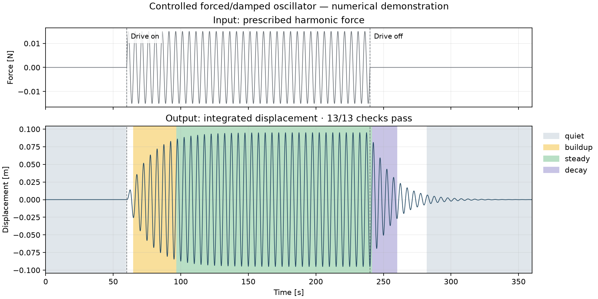

# runlog

Convert time-series test logs into a checked, tagged, and searchable dataset.

[](https://github.com/CabotHwang/runlog/actions/workflows/ci.yml)

I based the design of runlog on the data handling in my master's research on vortex-induced motion (VIM) of floating offshore wind turbines.
The examples use synthetic data.



## Install

Use Python 3.11 or later.
Create a virtual environment.
Install the library with the test, plot, and MySQL export dependencies.

```bash
python3 -m venv .venv
.venv/bin/python -m pip install -e '.[dev]'
```

## Quickstart

Run the example pipeline from the repository root. The second command redraws `docs/figures/record_timeline.png`.
The script creates 16 synthetic records with a fixed random seed.
Five records contain one fault each: a gap, a frozen sensor, spikes, clipping, and NaN values.
These records fail seven checks. One fault can cause more than one failed check.
The frozen sensor fails flatline while held and spikes at release.
Each channel includes seeded Gaussian sensor noise. Sway noise has a standard deviation of 0.5 mm.
The other channels have noise at 1% of their typical amplitude.
The sensor holds its last value for 3 s. Clipping limits the noisy sway signal to 70% of its amplitude.
The check command must exit with code 1 because these faults are present. The script stops if it does not.

```bash
bash examples/quickstart.sh
.venv/bin/python examples/plot_record.py
```

The script prints this output. Its last command runs the catalog query from the Catalog section.

```text
Records ingested: 16.
Records checked: 16. Failed checks: 7.
Records tagged: 16.
Dataset verified.
Catalog rebuilt.
record_id,vr,steady_rms_m
run_01,3.0,0.01642
run_02,3.467,0.02147
run_04,4.4,0.05486
run_05,4.867,0.08587
run_07,5.8,0.13897
run_08,6.267,0.13688
run_10,7.2,0.08088
run_11,7.667,0.05109
run_13,8.6,0.02044
run_14,9.067,0.01603
run_16,10.0,0.01425
```

## Dataset layout

```text
dataset/
  records/<record_id>.parquet
  records/<record_id>.json
  checks/<record_id>.json
  segments/<record_id>.json
  catalog.sqlite
```

Each Parquet file contains `time` in seconds and numeric channel columns.
Each record sidecar contains channel units, scalar attributes, sample count, source file name, schema version, and SHA-256 hash.
The `source` field stores only the file name, not the path.
The check sidecar stores `record_sha256`, `runlog_version`, `config`, and a `checks` list.
The segment sidecar stores `record_sha256` and a `channels` object.
Each channel entry contains `status`, `segments`, `runlog_version`, and `config`.
Each `config` object stores all fields of the configuration used for that analysis.
Tagging updates only the selected channel.
A missing channel gives `not_testable` and an empty segment list.
Verification and catalog builds reject analysis sidecars with a different record hash or missing version or configuration fields.
The catalog is a derived index.
Rebuild it after changes to records or sidecars.

Record identifiers start with a letter or digit.
They contain 1–64 letters, digits, underscores, dots, or hyphens.
Channel names are unique.
Each channel has a non-empty unit.
Attribute values are numbers, strings, or booleans.

Ingest accepts CSV, text OpenFAST `.out` files, and binary OpenFAST `.outb` files.
The binary reader supports FileIDs 1, 2, 3, and 4. It reports unsupported formats and truncated files as data errors.
Use `--units` with a JSON mapping from channel names to units for CSV inputs.
OpenFAST inputs use units from the file header.
Use `--time-column` to select the CSV time column.
Record ids use the file stem by default (`--id-from stem`).
Use `--id-from parent` to use the name of the parent directory. Duplicate record ids cause an error.
Use `--attrs` with a JSON mapping from record ids or file names to attribute dictionaries.
Ingest first looks for the record id, then the file name.
Use `--overwrite` to replace an existing record.
Each record write removes its previous check and segment sidecars.

The verify command reports missing files, extra files, hash mismatches, and invalid sidecars.
It ignores hidden files.

## Checks

Each result has status `pass`, `fail`, or `not_testable`.
The table gives the default rules.

| Check | Rule |
|---|---|
| `time_monotonic` | Timestamps are finite. Each time step is positive. |
| `sample_rate` | Gap steps are excluded. Each step differs from the median step by at most the larger of 1% of the median step and the timestamp resolution. If `expected_rate_hz` is set, the median rate must also match it within 1%. |
| `gaps` | No step exceeds three times the median step. |
| `duration` | Record duration is at least 10 s. |
| `non_finite` | Each channel has no NaN or infinite values. |
| `flatline` | Each run of identical values lasts at most 2 s. |
| `clipping` | Runs at channel limits contain at most 1% of samples. Each counted run has at least three samples. |
| `spikes` | No curvature-residual score exceeds 8. Each consecutive run above the limit counts as one event. The centered trend window has 7 samples. The centered scale window has 101 samples. |
| `derivative_pair` | Normalized RMS error between position gradient and velocity is at most 0.05. Pairs require configuration. |

The `spikes` check uses the second difference: `d2[i] = x[i-1] - 2*x[i] + x[i+1]`.
It uses the interior samples, where both neighbours are present.
The curvature residual is `r = d2 - rolling_median(d2)`.
This median uses `spike_detrend_window` samples (7 by default).
The spike score is `abs(r)` divided by the scale.
First, `m[i]` is the rolling median of `r` over `spike_window` samples.
Then, the residual scale is `1.4826 * rolling_median(abs(r - m))` over the same window.
Each absolute deviation uses the median at its own sample.
The scale is also at least the local interquartile range of `d2` divided by 1.349.
The interquartile range is the 75th percentile minus the 25th percentile over `spike_window` samples.
This lower limit prevents a zero residual scale on smooth curves.
All windows are centered and use the available samples at the record ends.
The scale is at least `8 * quantum / sqrt(2)`.
Uniform rounding error has variance `quantum**2 / 12`.
The second-difference weights give a variance six times as large, or a standard deviation of `quantum / sqrt(2)`.
The safety factor is 8 to allow smooth curvature when rounding gives a small local scale.
The quantum comes from the spacing of sorted unique channel values, with a tolerance for float32 rounding.
At least three distinct values must fit the same spacing or its integer multiples.
The estimate tests up to 32 subdivisions of the smallest observed spacing.
A channel with only two distinct values gives no quantum.
Each consecutive run of scores above `spike_z` counts as one event.
The check value is the number of events.
A zero scale gives a zero score for a zero residual and an infinite score for a nonzero residual.
If the scale and the residuals are all zero, the result is `not_testable`.
The `spike_window` and `spike_detrend_window` values are odd integers of at least three samples.
For the `sample_rate` check, timestamp resolution is the smallest nonzero absolute deviation from the median step that occurs in at least 5% of non-gap steps.
Gap steps and floating-point roundoff do not count.
Set `resolution_min_fraction` to change this fraction.
Set `expected_rate_hz` to require `abs(median_step * expected_rate_hz - 1) <= sample_rate_rel_tol`.
This rate limit does not increase with timestamp resolution.
The result message gives the expected and measured rates.

Checks return `not_testable` when required data are insufficient or invalid.
Examples include fewer than 10 samples, constant channels for clipping, and invalid time for checks that require increasing time.
Time monotonicity requires at least two samples.
Duration gives `not_testable` when timestamps are non-finite or not increasing.
Zero or one sample fails duration.
Non-finite values prevent other channel checks.

Use `check --config checks.json` to set `CheckConfig` fields.
Use `channels` in `--config` or `--channels a,b,c` to select channels; CLI values take priority, and time checks still run.
Use `tag --config segments.json` to set `SegmentConfig` fields.
The required `--noise-floor` value overrides any `noise_floor` in the config file.

| Exit code | Meaning |
|---|---|
| 0 | Command completes without reported failures. |
| 1 | The check command finds failed checks, or verification finds errors. |
| 2 | A usage or data error occurs. |

## Segment tags

The envelope is the rolling standard deviation.
Each value is the RMS about the mean of the same centered window.
The default window is 10 s.
At each record end, the window uses the available samples.
Set a positive noise floor in channel units.
Intervals include their start and exclude their end.

| Tag | Rule |
|---|---|
| `quiet` | The envelope is below the noise floor. |
| `steady` | Flat windows form a candidate interval. Each window lasts at least `min_steady_s` (30 s by default). The reported interval starts and ends where the envelope reaches `transition_high` times the candidate level. |
| `buildup` | Before steady, the envelope rises from below `transition_low` to at least `transition_high` times the steady level. The defaults are 0.3 and 0.9. |
| `decay` | After steady, the envelope follows the reverse buildup rule. |

A flat window has a range at most twice `rel_tol` times its median.
Its median is at least the noise floor.
The default `rel_tol` is 0.05.
The steady level is the median envelope inside the merged candidate interval.
The transition limits satisfy `0 < transition_low < transition_high <= 1`.
Slow transitions can satisfy the flatness rule and extend the steady interval.
Buildup and decay permit dips up to `rel_tol` times the steady level.
Other intervals have no tag.

Each segment stores `record_id`, `channel`, `start_s`, `end_s`, `tag`, `rms`, `peak_freq_hz`, `method`, and `method_version`.
The segment RMS is the RMS about the segment mean.
The method is `rolling_std`, version 2.
Peak frequency uses a Hann-window FFT.
Constant segments and segments shorter than the envelope window have no peak frequency.
Records shorter than twice that window give `not_testable`.

## Catalog

The index command rebuilds the SQLite catalog in one transaction.
An atomic file replacement installs the completed catalog.
Foreign keys link each child table to `records`.
Indexes cover `segments(tag)`, `attrs(key, value_num)`, and `checks(record_id, status)`.

| Table | Columns |
|---|---|
| `records` | `record_id`, `n_samples`, `duration_s`, `sample_rate_hz`, `sha256`, `source` |
| `channels` | `record_id`, `name`, `unit` |
| `attrs` | `record_id`, `key`, `value_num`, `value_text` |
| `checks` | `record_id`, `check_name`, `channel`, `status`, `value`, `threshold`, `message` |
| `segments` | `segment_id`, `record_id`, `channel`, `start_s`, `end_s`, `tag`, `method`, `method_version`, `rms`, `peak_freq_hz` |

Numeric and boolean attributes use `value_num`. Booleans are stored as 1 or 0.
String attributes use `value_text`.
The query command opens the catalog in read-only mode.
An SQLite authorizer blocks writes and database attachment.
Select table, CSV, or JSON output with `--format`.

Use this query to list steady RMS against reduced velocity for records with no failed checks:

```bash
.venv/bin/python -m runlog query --dataset examples/output/dataset \
  "SELECT s.record_id, ROUND(a.value_num, 3) AS vr, ROUND(s.rms, 5) AS steady_rms_m FROM segments s JOIN attrs a ON a.record_id = s.record_id AND a.key = 'vr' WHERE s.tag = 'steady' AND NOT EXISTS (SELECT 1 FROM checks c WHERE c.record_id = s.record_id AND c.status = 'fail') ORDER BY a.value_num" \
  --format csv
```

## SQL

The default catalog is a local SQLite file. It needs no server.
Export the catalog when users need a shared database.
The export uses SQLAlchemy Core and is tested on MySQL 8.4.
Install the `mysql` extra to use export.

Set the database URL in the environment. Keep credentials outside code and SQL files.

```bash
export RUNLOG_DB_URL='mysql+pymysql://runlog@db.example/runlog'
.venv/bin/python -m runlog export --dataset examples/output/dataset
```

Export prints the row count for each table.
Use `--replace` to drop and recreate existing catalog tables.
On MySQL, `DROP TABLE` and `CREATE TABLE` commit immediately, so a failed export can leave empty tables. All row inserts run in one transaction.

The six named queries in `examples/queries.sql` run on SQLite 3.35 or later and on MySQL 8.4.
Run a named query on the local catalog:

```bash
.venv/bin/python -m runlog query --dataset examples/output/dataset \
  --file examples/queries.sql --name check_failure_rates --format csv
```

This query counts failed results and calculates their share of all check results:

```sql
SELECT check_name,
       SUM(CASE WHEN status = 'fail' THEN 1 ELSE 0 END) AS failure_count,
       1e0 * SUM(CASE WHEN status = 'fail' THEN 1 ELSE 0 END) / COUNT(*) AS failure_rate
FROM checks
GROUP BY check_name
ORDER BY check_name;
```

The demo returns this output:

```text
check_name,failure_count,failure_rate
clipping,1,0.015625
duration,0,0.0
flatline,1,0.015625
gaps,1,0.0625
non_finite,1,0.015625
sample_rate,0,0.0
spikes,3,0.046875
time_monotonic,0,0.0
```

CI runs all named queries on MySQL 8.4 and compares their results with SQLite.

## Python API

```python
from runlog import CheckConfig, SegmentConfig, load_record, run_checks, tag_segments

frame, meta = load_record("examples/output/dataset", "run_01")
checks = run_checks(frame, meta.record_id, CheckConfig())
report = tag_segments(
    frame.time, frame.sway, meta.record_id, "sway", SegmentConfig(noise_floor=0.005)
)
```

## Limits

Ingest preserves time errors for later checks.
Segment tagging assumes uniform sample spacing and uses the median time step.
Check the time results before you use segment tags.
A passed check does not establish physical validity.
A channel that holds a constant value for part of a record, such as the speed of a stopped carriage, can fail the flatline and clipping checks with the default thresholds. A fully constant channel fails flatline and gives `not_testable` for clipping.
Use `--config` to set thresholds for your data. One configuration applies to all selected channels in a `check` run.
A channel that is constant by design fails flatline unless it is left out of the channel selection.
A step change counts as a spike event.
Spike sensitivity falls when the sampling rate is low compared with the signal frequency.
Sharp physical features, such as an angle wrap or a tower passage in a blade load, count as events.
Use `--channels` to select channels or set a larger `spike_z` for these channels.
Rounded or simulated data with repeated extrema can fail the clipping check.
A slow ramp between plateaus can extend a steady interval and bias its RMS.
A mean drift during a transition can leave the transition without a tag.
Numerical differentiation amplifies position noise, so the derivative-pair check needs low noise or a larger tolerance.

## License

See [LICENSE](LICENSE) for the MIT license.
